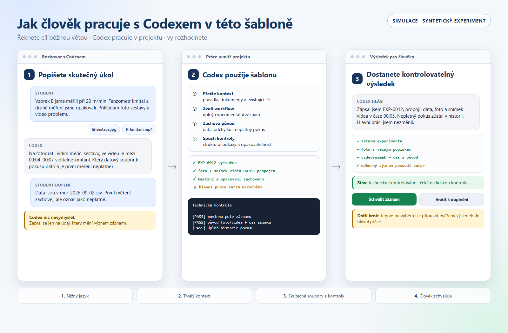

# Ukázka: člověk pracuje s Codexem

Tato simulace ukazuje běžný pracovní cyklus uvnitř šablony. Člověk nemusí znát
LaTeX, strukturu složek ani interní názvy workflow. Popíše skutečný úkol normální
větou; Codex použije projektový kontext, upraví dohledatelné soubory, provede
technické kontroly a vrátí výsledek člověku k rozhodnutí.

*Simulace se syntetickým experimentem. Nejde o screenshot konkrétní verze rozhraní
Codexu ani o skutečná naměřená data.*

## Co se v ukázce děje

1. Student hrubě popíše měření, přiloží fotografii sestavy a krátké video problému.
2. Codex popíše viditelný obsah, vybere relevantní videosnímek s časem a nevymyslí
   chybějící odborný údaj; položí konkrétní doplňující otázku.
3. Po odpovědi vytvoří experimentální záznam se stabilním ID, zachová i neplatný
   pokus a propojí původní data, fotografii i video.
4. Spustí technické kontroly a oznámí, co změnil a co naopak nezměnil.
5. Autor rozhodne, zda je záznam věcně správný a zda se má něco vybrat do hlavní
   práce.

## Ukázkové zadání

> Dnes jsme zkoušeli vzorek B při rychlosti 20 metrů za minutu. Tenzometr na začátku
> kmital a druhé měření jsme opakovali. Zapiš to do experimentálního deníku a připrav
> podklady, které by později mohly být použitelné v hlavní práci. Přikládám fotografii
> sestavy a krátké video kmitání; popiš jen viditelné skutečnosti a vhodný snímek z
> videa zachovej s časovou pozicí.

Takové zadání neříká, kam se má co uložit ani který skript spustit. To řeší pravidla
šablony. Codex se však musí doptat, pokud chybějící údaj mění význam nebo
opakovatelnost, a nesmí automaticky přesunout předběžný závěr do hlavního textu.
U experimentální fotografie nebo videa musí zachovat původ, rozlišit pozorování od
interpretace a nesmí generativní úpravou změnit důkazní obsah.

## Proč je to silnější než samostatný chat

- Codex pracuje nad dlouhodobým `PROJECT_CONTEXT.md`, nikoli jen nad poslední zprávou;
- používá stabilní ID experimentů, zdrojů, výpočtů a kontrolních bodů;
- upravuje skutečné projektové soubory a zachovává jejich historii;
- může spustit kompilaci, audit, kontrolu dat nebo jiný reprodukovatelný test;
- výslovně odděluje technicky ověřený návrh od lidsky schváleného obsahu.

Další konkrétní zadání jsou v katalogu
[Co můžete zadat Codexu a co potom udělá](../ZADANI_PRO_CODEX.md).
