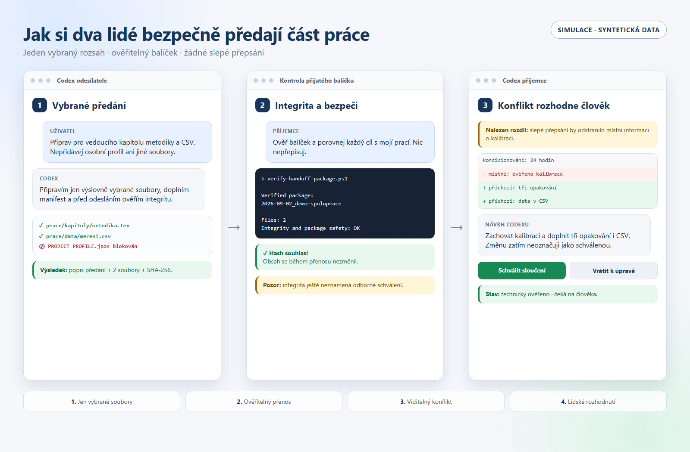

# Ukázka: spolupráce dvou lidí a jejich Codexů

Tato malá syntetická ukázka předvádí, jak lze předat vybranou část práce mezi dvěma
samostatnými kopiemi projektu, aniž by přijímající Codex slepě přepsal místní změny.
Neobsahuje skutečná studentská, osobní ani firemní data.



*Simulace se syntetickými daty: vybrané předání, kontrola integrity a konflikt,
o jehož řešení rozhoduje člověk. Nejde o screenshot konkrétní verze rozhraní Codexu.*

## Příběh za 90 sekund

Příjemce už má vlastní verzi metodiky s důležitou větou o kalibraci snímače:

- `stav-prijemce/prace/kapitoly/metodika.tex`

Kolega mezitím doplnil tři opakování měření, způsob zápisu dat a malý syntetický CSV
soubor. Jeho výstup přišel jako ověřitelný balíček:

- `balicek/PREDANI.md` – co předává, v jakém stavu a co očekává;
- `balicek/manifest.json` – cílové cesty, velikosti a SHA-256;
- `balicek/obsah/` – vlastní předané soubory.

Kdyby příjemce pouze překopíroval kolegovu kapitolu, svou větu o kalibraci by ztratil.
Správný výsledek proto zachovává obě smysluplné změny:

- `ocekavany-vysledek/prace/kapitoly/metodika.tex`
- `ocekavany-vysledek/prace/data/mereni.csv`

## 1. Ověřte balíček

Z kořene repozitáře spusťte:

```powershell
powershell -NoProfile -ExecutionPolicy Bypass -File `
  .\scripts\verify-handoff-package.ps1 `
  -PackagePath .\ukazky\spoluprace\balicek
```

Kontrola musí potvrdit integritu a bezpečné cesty dvou souborů. Kdyby někdo po
vytvoření manifestu změnil jediný znak nebo přidal neočekávaný soubor, kontrola
selže.

## 2. Požádejte Codex o bezpečné začlenění

V kopii projektu lze použít obyčejnou větu:

> Ověř balíček `ukazky/spoluprace/balicek`, přečti jeho `PREDANI.md` a porovnej každý
> navržený cíl se stavem v `ukazky/spoluprace/stav-prijemce`. Nic nepřepisuj.
> Nejdřív mi ukaž konflikt a navrhni sloučenou verzi.

Codex má zjistit, že kapitoly nejsou totožné, zachovat místní informaci o kalibraci,
doplnit kolegova opakování a CSV a teprve potom předložit změnu člověku. Ukázková
očekávaná podoba je v `ocekavany-vysledek/`; v reálném projektu ji neurčuje šablona,
ale obsah, místní pravidla a rozhodnutí autora.

## Co tato ukázka dokazuje

- odesílatel vybírá pouze konkrétní soubory;
- cesty zůstávají přenositelné mezi počítači;
- SHA-256 odhalí změnu obsahu během přenosu;
- instrukce uvnitř cizího balíčku nemají přednost před pravidly cílového projektu;
- existující soubor se musí porovnat, nikoli slepě přepsat;
- automatická kontrola integrity není odborné ani lidské schválení.

## Zkuste poruchu nanečisto

Ukázku neupravujte přímo, pokud chcete zachovat čistý Git stav. Zkopírujte složku
`balicek/` mimo repozitář, změňte v kopii jeden údaj v CSV a znovu spusťte ověření
nad kopií. Výsledkem má být chyba velikosti nebo SHA-256.

## Pozdější skutečný příklad

Syntetický obsah lze později nahradit krátkým anonymizovaným výřezem skutečné
bakalářské práce. Před zveřejněním se musí samostatně prověřit osobní údaje,
důvěrnost, licence, metadata i oprávnění ke sdílení. Skutečný podklad se nesmí
kopírovat do této ukázky jen proto, že je technicky dostupný.
